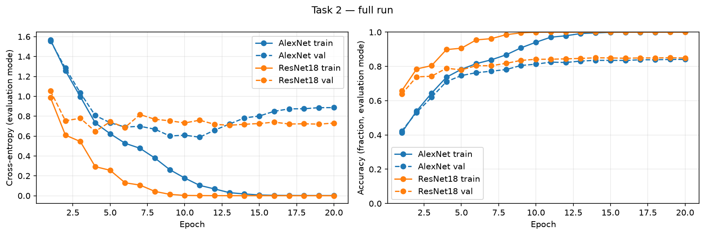

# Task 2 results

Both models completed 20 epochs on 45,000 CIFAR-10 training images, with 5,000
images for validation. Each model processed 900,000 training examples across the
20 epochs. The run used seed 2223, batch size 64 and an NVIDIA GeForce RTX 3050 Ti
Laptop GPU. The official test set has not been evaluated.

| Model | Best validation accuracy | Selected epoch | Parameters | Total run time |
|---|---:|---:|---:|---:|
| AlexNet | 84.10% | 20 | 6,976,842 | 9.84 min |
| ResNet-18 | 85.08% | 19 | 11,173,962 | 23.20 min |

Total time includes training, evaluation and saving results. Checkpoints were
selected by validation accuracy, with validation loss used to break ties.
`best_val_loss` in `comparison.csv` is the loss at the selected checkpoint.
Both checkpoints reproduced their recorded validation scores when reloaded.

ResNet gained 0.98 percentage points in validation accuracy and took 2.36 times
as long. Both models reached almost 100% training accuracy and showed overfitting.
The notebook contains the full discussion, including why validation loss can
increase while accuracy improves. This comparison uses one seed and one split.

The history CSV files contain the metrics for every epoch. `comparison.csv`
summarizes the runs. The shape tables and `architectures.csv` describe the models.
`config.json` records the settings, normalization statistics and runtime versions.
`split_ids.npz` contains the training and validation image IDs, and
`verification.json` records the checkpoint checks.

These files are an unchanged copy of the completed run in
`assignments/ass1/outputs/task2/full_20261117T213705Z_b52818aa/`.
Checkpoint paths in `comparison.csv` are relative to `assignments/ass1`.
The `.pt` model weights stay in that local output directory and are excluded from
Git. To evaluate a checkpoint on another computer, obtain those weights separately
or rerun training.

To reproduce the experiment, open `assignments/ass1/lab-assignment-notebook.ipynb`
with an environment containing the dependencies in `pyproject.toml`. Keep
`RUN_MODE = "full"` and run Task 1 followed by Task 2. Each execution creates a new
directory under `outputs/task2/`. Keep `RUN_FINAL_TEST = False` while selecting
models and settings for the later tasks. Hardware or software changes may affect
timing and numerical results.
